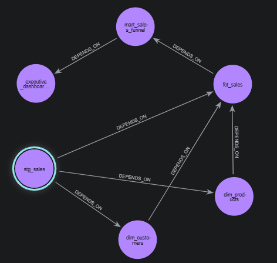
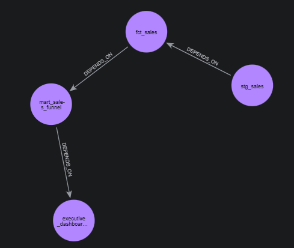

# Neo4j Data Lineage (Pet-проект для себя)

Визуализация зависимостей моделей dbt в графовой базе данных Neo4j.

## 🎯 Цель
Попробовать графовую БД (Neo4j) и понять, как она работает с Data Lineage. 
Проект не для резюме, а для личного ознакомления с Cypher и графовыми запросами.

## 🛠 Стек
- **Neo4j (Docker):** Графовая СУБД.
- **Python (neo4j driver):** Загрузка данных из скрипта.
- **Cypher:** Язык запросов к графу.

## 📊 Что было сделано
1. Развернут Neo4j в Docker с лимитами памяти (Heap 1G, PageCache 512M).
2. Написан Python-скрипт `load_lineage.py`, который создает узлы (модели) и связи (`DEPENDS_ON`).
3. Выполнены запросы на Cypher:
   - `MATCH (n:Model) RETURN n` — все узлы.
   - `MATCH path = (a:Model)-[:DEPENDS_ON*]->(b:Model) RETURN path` — все пути.
   - `MATCH p = shortestPath((start:Model {name: 'stg_sales'})-[:DEPENDS_ON*]->(end:Model {name: 'executive_dashboard'})) RETURN p` — кратчайший путь от источника до дашборда.

## 💡 Выводы
Графовая БД позволяет визуализировать поток данных нагляднее, чем классические ER-диаграммы. Neo4j в Docker с ограничением памяти работает стабильно даже на слабом железе.

### Полный граф зависимостей (все 6 моделей):

### Кратчайший путь от источника до дашборда:
